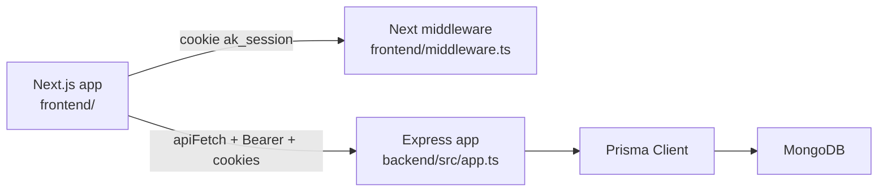
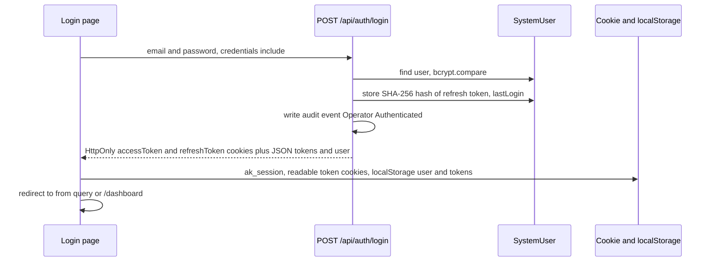
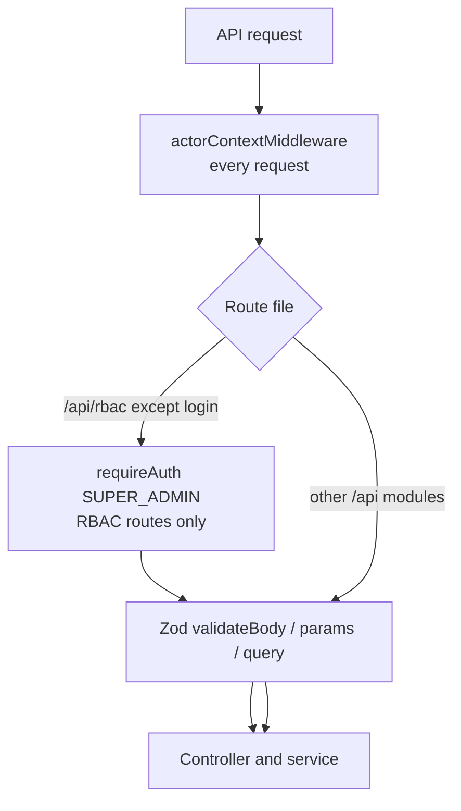
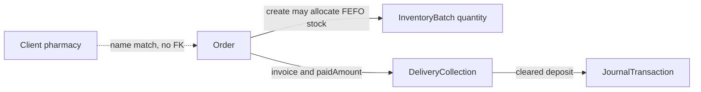
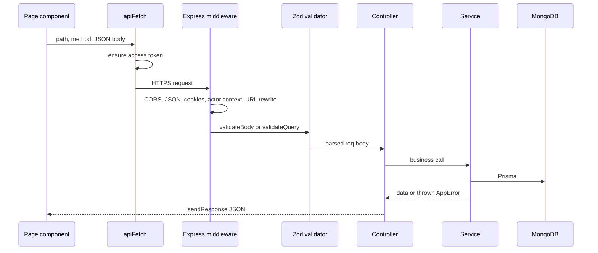

# System Overview

AK Pharma Management System is an internal pharmaceutical ERP for a distributor or manufacturer. It covers warehouse stock, doctor and field-force activity, pharmacy sales, procurement, treasury, payroll, and role-based access with an audit trail.

This document describes behavior found in the repository. Related detail lives in [FRONTEND_GUIDELINES.md](./FRONTEND_GUIDELINES.md), [BACKEND_ARCHITECTURE.md](./BACKEND_ARCHITECTURE.md), [AUTHENTICATION.md](./AUTHENTICATION.md), and [UI_UX_GUIDELINES.md](./UI_UX_GUIDELINES.md).

## Purpose

Operators use one web app to:

- Register doctors and log Medical Information Officer (MIO) visits.
- Track pharmacy clients, sales orders, invoices, and collections in BDT.
- Buy from wholesalers and receive stock into batch-level inventory.
- Dispatch stock first-expired, first-out (FEFO).
- Record cash and bank movements, expense vouchers, and party settlements.
- Maintain staff records and salary rows.
- Control module access through a permission matrix and record audit events.

There is no customer-facing storefront and no external payment gateway.

## Technology stack

| Area | What is implemented |
|---|---|
| Frontend | Next.js 16.3 App Router, React 19, TypeScript, Tailwind CSS v4 |
| UI | shadcn/ui (`radix-nova` style), Radix primitives, Lucide icons, Sonner toasts, Recharts |
| Backend | Express 4, TypeScript, run with `tsx` in development |
| Data | Prisma 5 with **MongoDB** (`backend/prisma/schema.prisma` `provider = "mongodb"`) |
| Auth | JWT access and refresh tokens, bcrypt password hashes |
| Validation | Zod 4 on both sides |
| Spreadsheets | `xlsx` in the browser for import and export |
| Deploy hook | `backend/vercel.json` rewrites traffic to `backend/api/index.ts` |

The root `README.md` and the previous root `AGENTS.md` described PostgreSQL. The Prisma datasource is MongoDB. Trust the schema.

`@supabase/supabase-js` and `@supabase/ssr` are listed in `backend/package.json`. No application source imports them. They are unused dependencies.

## High-level architecture



The frontend and backend are separate Node apps. The frontend does not use Next.js Route Handlers as the API. Pages call the Express server through `frontend/lib/api.ts`.

Default local addresses:

- UI: `http://localhost:3000`
- API: `http://localhost:5000`
- API prefix: `http://localhost:5000/api`

## How the frontend talks to the backend

`getApiUrl()` in `frontend/lib/api.ts` reads `NEXT_PUBLIC_API_URL`. If the value is missing it uses `http://localhost:5000/api`. It always ends the base URL with `/api`.

`apiFetch()`:

1. Refreshes the access token when it is missing or within 5 seconds of expiry.
2. Sends `Authorization: Bearer <accessToken>`.
3. Sends `credentials: "include"` so cookies travel with the request.
4. Adds `x-user-email`, `x-user-name`, and `x-user-role` from the user stored in `localStorage`.
5. On HTTP 401, refreshes once and retries.
6. If refresh fails, clears the session and redirects to `/login?expired=1`.

Login itself uses plain `fetch` to `POST /api/auth/login`, not `apiFetch`, so a missing token does not trigger a refresh loop. See `frontend/app/login/page.tsx`.

Successful JSON from business endpoints uses `sendResponse` in `backend/src/utils/response.ts`:

```json
{
  "success": true,
  "statusCode": 200,
  "message": "Doctors retrieved successfully",
  "data": {},
  "meta": {}
}
```

`meta` is present on paginated lists. The health check at `GET /health` and `GET /api/health` uses a different shape: `{ status, service, uptimeSeconds, timestamp }`.

## Database overview

Prisma models live in `backend/prisma/schema.prisma`. IDs are MongoDB ObjectIds (`@db.ObjectId`). Several line-item shapes are embedded composite types, not separate collections: `OrderItem`, `PurchaseOrderItem`, `ExpenseVoucherLineItem`, `SettlementAllocation`, `AdvanceDraw`.

Two different “role” models exist:

| Model | Used for |
|---|---|
| `SystemRole`, `RolePermission`, `SystemUser` | Login accounts and the RBAC matrix |
| `Role`, `Staff` | HR job titles attached to employees |

A staff member is not automatically a system user. Provisioning a login is a separate RBAC action.

### Collections by area

| Area | Models |
|---|---|
| Clinical | `Doctor`, `DoctorVisitLog` |
| Field force | `Territory`, `MioZoneAllocation`, `TerritoryTarget` |
| Sales | `Client`, `Order` |
| Procurement | `Wholesaler`, `PurchaseOrder` |
| Warehouse | `Product`, `ProductBatch`, `InventoryBatch`, `StockAdjustment` |
| Treasury | `FinancialAccount`, `JournalTransaction`, `TreasuryDeposit`, `DeliveryCollection`, `ExpenseVoucher`, `PartySettlement` |
| HR | `Staff`, `Role`, `Salary` |
| Security | `SystemUser`, `SystemRole`, `RolePermission`, `AuditLog` |

Money fields are `Float` and represent BDT. Dates on many business documents are stored as strings (`orderDate`, `visitDate`, `expiryDate`), not `DateTime`.

Relationships that Prisma enforces:

- `Staff` belongs to optional `Role`; has many `Salary` and `MioZoneAllocation`.
- `Product` has many `ProductBatch` and `InventoryBatch`.
- `ProductBatch` optionally points at a purchase order id and an inventory batch id.
- `FinancialAccount` has debit and credit `JournalTransaction` rows.
- `SystemUser` belongs to `SystemRole`; `RolePermission` belongs to `SystemRole`.
- `AuditLog` optionally belongs to `SystemUser`.

`Client` and `Order` are not linked by a foreign key. Orders store `pharmacyName` and territory text. Collections store `orderId` and `invoiceNo` as strings.

## Modules

The permission catalog in `backend/src/constants/moduleCatalog.ts` is the source of module names. The sidebar in `frontend/components/app-sidebar.tsx` follows the same groups.

| Group | Pages | Responsibility |
|---|---|---|
| Overview & Analytics | `/dashboard`, `/analytics/targets`, `/analytics/territories`, `/field-force/zones` | KPIs, quotas, territory analytics, MIO zone assignment |
| Doctor Management | `/doctors/database`, `/field-force/visit-logs` | Doctor registry and visit logs |
| Inventory & Warehouse | `/inventory/ledger`, `/inventory/adjustments` | Batch stock and quantity corrections |
| Sales & Deliveries | `/logistics/orders`, `/sales/clients` | Sales orders and pharmacy accounts |
| Finance & Treasury | `/finance/overview`, `/finance/bank-ledger`, `/finance/collections`, `/finance/supplier-payments`, `/procurement/orders`, `/finance/payments` | Cash position, journals, collections, supplier settlement, purchase orders, expense vouchers |
| HR & System Control | `/hr/staff-directory`, `/hr/salary`, `/settings/rbac`, `/settings/audit-logs` | Employees, payroll rows, security matrix, audit trail |

Two App Router pages exist and are **not** in the sidebar or the module catalog:

- `frontend/app/doctors/timeline/page.tsx`
- `frontend/app/field-force/approvals/page.tsx`

`featureForPath()` returns null for them, so the layout allows them for any signed-in user.

## Roles and permissions

Seed data creates a `SystemRole` named Super Administrator with code `SUPERADMIN` (`backend/prisma/seed.ts`). Other roles are created in the RBAC screen and stored as `SystemRole` rows.

Each `RolePermission` row is one module for one role:

- `read`, `create`, `edit`, `delete`
- optional `specialAction` label and `specialGranted` flag
- `overviewGrants` JSON for individual dashboard or summary cards

Super-admin detection on the client (`isUserSuperAdmin` in `frontend/lib/auth.ts`) treats these as full access:

- email containing `superadmin`, or the address `toshin@akpharma.com`
- role text that normalizes to include `SUPERADMIN` or `SUPERADMINISTRATOR`

If a non-super-admin session has an empty `permissions` array, `userCan()` returns true. Once any permission rows are stored, missing modules are denied.

Backend `requireAuth` and `requirePermission` live in `backend/src/middlewares/requireAuth.ts`. **Only** `backend/src/routes/rbacRoutes.ts` calls `requireAuth("SUPER_ADMIN")`. `requirePermission` is not mounted on any route. Other business routes validate input with Zod and then run the controller. The browser still hides pages, but the API does not enforce the matrix except on RBAC endpoints.

## Authentication workflow



Implemented details:

- Access token payload: `userId`, `email`, `role` (role **code**). Signed with `JWT_ACCESS_SECRET`. Default expiry `15m`.
- Refresh token payload: `userId`, `tokenId`. Signed with `JWT_REFRESH_SECRET`. Default expiry `7d` unless `JWT_REFRESH_EXPIRES_IN` overrides it.
- Refresh rotation compares the token to `SystemUser.refreshTokenHash` and replaces the hash (`authService.refreshToken`).
- Logout clears the stored hash when the refresh cookie is present and clears both cookies.
- Restricted users (`status === "Restricted"`) cannot log in.
- Login time is formatted in `Asia/Dhaka`.

The backend also sets **HttpOnly** `accessToken` and `refreshToken` cookies. The browser **also** writes the same token values into non-HttpOnly cookies and `localStorage` inside `setAuthSession`. Both copies are real. Middleware only sees cookies. `apiFetch` prefers a non-expired token from cookie or `localStorage`.

`frontend/middleware.ts` treats a session as valid when any of these is true:

- cookie `ak_session=true`
- a non-expired `refreshToken` cookie
- a non-expired access token cookie (`accessToken`, `token`, or `ak_token`)

`/` redirects to `/dashboard` or `/login`. Unauthenticated visits to other pages redirect to `/login?from=<path>`. `/settings/rbac` additionally checks `ak_role` and `ak_rbac`. A signed-in user without clearance is sent to `/dashboard?unauthorized=rbac` and is not logged out.

The root layout repeats a client-side auth check and, for catalogued routes, blocks the page body when `userCan(..., "view")` is false.

## Authorization workflow



`actorContextMiddleware` (`backend/src/middlewares/actorContextMiddleware.ts`) runs for every request. It fills an async-local actor from the bearer token, cookies, `x-user-*` headers, or body fields such as `email` and `createdBy`. Audit logging reads that context. It does not reject anonymous requests. An invalid token is ignored and the request continues.

## Main business workflows

### Doctor registry

`Doctor` rows are keyed by unique `bmdcRegNumber`. The doctors page validates with `doctorFormSchema`, then `POST /api/doctors`. Excel import parses the file in the browser and `POST /api/doctors/bulk-import` sends JSON. There is no multipart upload.

### Visit logs

`DoctorVisitLog` stores the doctor name, MIO, territory, drugs, and samples as strings. It does not use a foreign key to `Doctor` or `Staff`.

### Sales order and collection



`orderService` creates numbers like `SO-2026-0001` and challans like `DC-2026-####` inside a Prisma transaction. New orders default to status `FEFO Allocated` when the caller does not send one. Status `Delivered & Invoiced` and `Cancelled` take extra stock and audit paths. Payment status on the order is `UNPAID`, `PARTIALLY_PAID`, or `PAID`, derived from `paidAmount` versus `orderValue`.

Collections (`DeliveryCollection`) record cash, cheque, BEFTN / RTGS, or bKash / Nagad against an invoice. Clearance can post into a `FinancialAccount`.

### Procurement and FEFO stock

A `PurchaseOrder` moves through string statuses: `Draft`, `Submitted`, `Approved`, `Partially Received`, `Received`, `Cancelled`. Receiving stock creates `Product` / `ProductBatch` / `InventoryBatch` rows in a transaction (`purchaseOrderService`).

`calculateFefoMeta` in `backend/src/services/inventoryService.ts` classifies a batch from `expiryDate`:

| Days to expiry | Status |
|---|---|
| 0 or less | Expired |
| 1–60 | Near Expiry |
| 61–180 | Priority Out |
| more than 180 | Healthy |

A bin name containing `quarantine`, `[QUARANTINE]`, or starting with `Q-` marks the batch quarantined. List queries can order by earliest expiry.

`StockAdjustment` records write-offs, quarantine transfers, count discrepancies, and inward corrections. It stores SKU and batch number as strings.

### Treasury

`FinancialAccount.category` is `BANK` or `CASH`. `JournalTransaction.flowType` is `INFLOW`, `OUTFLOW`, `TRANSFER`, or `LOAN`. Account balance changes and journal rows are written inside `prisma.$transaction` in the ledger, collection, payment, and settlement services.

`ExpenseVoucher` is the payments screen. It supports draft through disbursed statuses, TDS/VDS amounts, and line items. `PartySettlement` allocates an incoming or outgoing payment across documents and can hold unallocated advance.

`TreasuryDeposit` records a cash or bank drop from a sales rep. The finance overview service aggregates these records for the treasury page. It does not call a bank API.

### Payroll

`Salary` is unique per `staffId` and `payPeriod`. Net pay is stored on the row. `PaymentStatus` is `PENDING`, `PAID`, or `PROCESSING`. The screen does not submit wages to a bank.

### Audit trail

`auditLogService.recordAuditEvent` writes `AuditLog` with actor, module, action, before/after payloads, a SHA-256 `sha256Hash`, and `previousHash`. The audit page exports that ledger to Excel. The model comment cites 21 CFR Part 11. The code implements an append-style hash chain and optional reason text. It does not implement electronic signatures as a separate signing ceremony beyond the stored `signerName` and `signatureMeaning` fields.

## API communication lifecycle



Controllers use `catchAsync`. Thrown `AppError`, `ZodError`, and Prisma errors reach `globalErrorHandler`.

## Data flow for a typical mutation

1. The page keeps form state in `useState`.
2. Zod `safeParse` runs in the browser when a schema exists.
3. `toast.loading` starts.
4. `apiFetch` posts JSON.
5. The route schema parses the body again.
6. The service writes Prisma data and, for audited modules, an `AuditLog` row.
7. The page reads `response.ok` and `message`, then `toast.success` or `toast.error`, and reloads the list.

List screens do not keep the full collection and page it locally. They request `page`, `limit`, search, sort, and filters. Audit Logs and the RBAC operator table use `useServerListQuery`, `ServerListToolbar`, and `ServerListPagination` in `frontend/components/server-list-controls.tsx`. The service returns one page and `meta.total` / `meta.totalPage`.

## File handling

There is no server upload middleware and no object storage in use.

| Action | Where it happens |
|---|---|
| Excel import | Browser reads `.xlsx` with `xlsx`, posts JSON to `/bulk-import` |
| Excel export | Browser builds a workbook and downloads it |
| Avatar | `FileReader.readAsDataURL` in the root layout; saved only in `localStorage` key `ak_user` |

## Payments

No Stripe, bKash merchant API, or other gateway is integrated. “Payment” means internal vouchers, collections, settlements, and journal postings. Method labels include Cash, Cheque, BEFTN / RTGS, Pay Order, and bKash / Nagad as recorded tender types.

## Third-party integrations

| Integration | Status |
|---|---|
| MongoDB via `DATABASE_URL` | Required |
| JWT secrets | Required at process start |
| Vercel rewrite for the API | Configured in `backend/vercel.json` |
| Supabase | Dependency only, unused |
| Email, SMS, maps, payment gateways | Not implemented |

## Environment configuration

Names only. Do not copy values into chat, commits, or docs.

Backend `backend/.env`, loaded by `backend/src/config/index.ts`:

| Variable | Required | Role |
|---|---|---|
| `DATABASE_URL` | Yes | MongoDB connection string |
| `JWT_SECRET` | Yes | Loaded into config. Token signing uses the two secrets below |
| `JWT_ACCESS_SECRET` | Yes | Access token signing |
| `JWT_REFRESH_SECRET` | Yes | Refresh token signing |
| `JWT_ACCESS_EXPIRES_IN` | No | Defaults to `15m` |
| `JWT_REFRESH_EXPIRES_IN` | No | Defaults to `7d` |
| `SALT_ROUNDS` | No | bcrypt cost, default `12` |
| `PORT` | No | Default `5000` |
| `NODE_ENV` | No | Default `development`. `production` marks auth cookies `Secure` and `SameSite=None` |

Frontend `frontend/.env.local`:

| Variable | Role |
|---|---|
| `NEXT_PUBLIC_API_URL` | API base. Code appends `/api` if it is missing. Fallback `http://localhost:5000/api` |

The process throws on startup if a required backend variable is missing.

## Development setup

Prerequisites: Node.js 20 or newer, and a MongoDB database.

```bash
cd backend
npm install
npx prisma generate
npx prisma db push
npm run seed
npm run dev
```

```bash
cd frontend
npm install
npm run dev
```

`npm run seed` creates the super-admin role and user. Credentials are defined in `backend/prisma/seed.ts` and repeated in the root `README.md`. Do not duplicate those secrets into new documents.

Other backend scripts: `npm run build`, `npm start`, `npm run test:e2e`, `npm run test:audit`, `npm run test:staff`.

Frontend scripts: `npm run build`, `npm run lint`, `npm run typecheck`, `npm run format`. `frontend/next.config.ts` sets `typescript.ignoreBuildErrors: true`, so `next build` does not fail on type errors. `npm run typecheck` still runs `tsc --noEmit`.

Prisma Studio: `npx prisma studio` from `backend`. Schema sync for MongoDB in this repo is `npx prisma db push`, not SQL migrations. The `prisma/migrations` folder is not part of the current layout.

## Build and deployment

- Frontend production build: `next build` then `next start`.
- Backend production build: `tsc` writes `dist/`, and `npm start` runs `node dist/server.js`.
- Vercel-style hosting for the API uses `backend/api/index.ts`, which forwards the request into the Express app. `backend/src/app.ts` also rewrites `__url`, `x-matched-path`, and `x-forwarded-uri` so those rewrites reach the right route.
- CORS reflects the request origin and allows credentials. There is no fixed allow-list.

A frontend hosting project (Vercel project, domain, or CI workflow) is not defined in this repository.

## Module dependencies that matter when changing code

- Sales orders depend on inventory quantities and on client names, not on a client foreign key.
- Collections and expense vouchers update financial accounts. Changing amount fields without the existing transaction blocks will desync balances.
- Purchase-order receipt creates product and inventory batches. Editing batch quantity in one model is mirrored by `productBatchService`.
- RBAC module strings must match `ALL_SYSTEM_MODULES` and `ROUTE_FEATURES` in `frontend/lib/permissions.ts`. Renaming a module in only one file hides or exposes the wrong page.
- Audit events are written inside services. A controller-only change will not record a statutory log.
- `SystemRole` and HR `Role` must not be merged. Staff assignment and login clearance are separate.

## Gaps verified in source

- Most API routes do not require a logged-in user.
- Permission checks are enforced in the UI and on RBAC routes, not on every service.
- `requirePermission` is unused.
- Supabase packages are unused.
- Dark theme tokens exist, but the shell forces light mode. See the UI guide.
- Profile name and avatar edits stay in the browser. They do not call an API.
